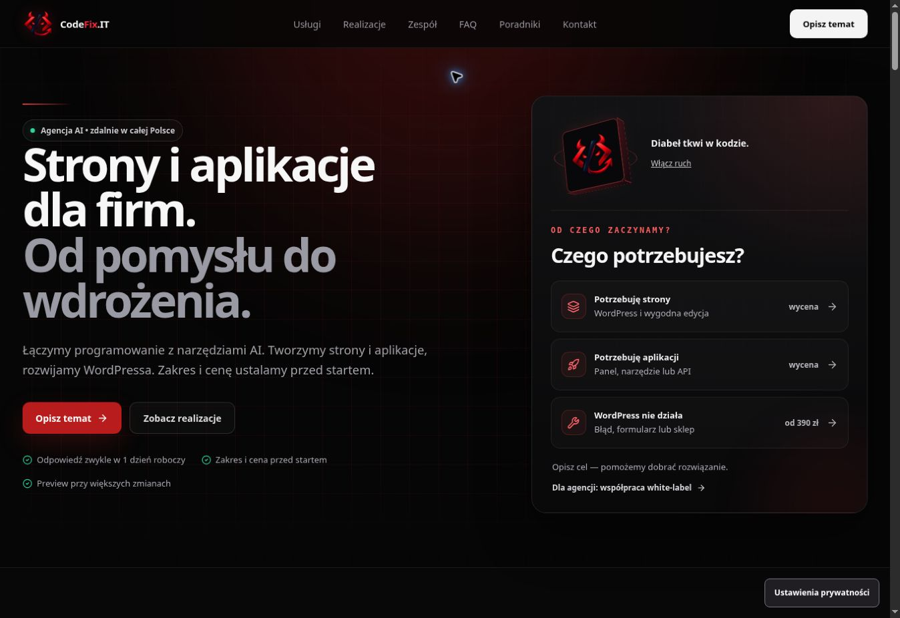
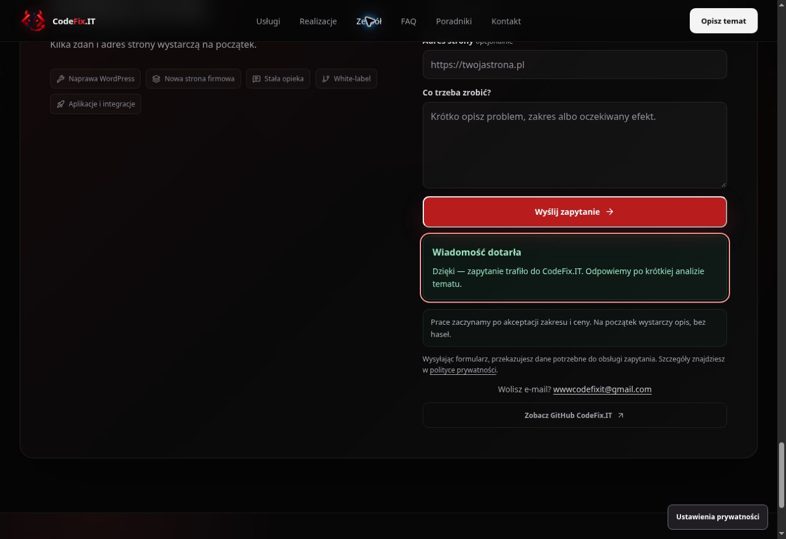

# CodeFix.IT — treść wspólnej agencji i czytelność

Założenie robocze: CodeFix.IT tworzy strony i aplikacje z wykorzystaniem AI jako narzędzia projektowania i programowania. Użytkownik wskazał wspólną agencję jego i Marka. Wariant przedstawia zespół jako „Patryk i Marek”; nie dodaje niepotwierdzonych biografii, specjalizacji, referencji ani wyników projektów. Dokładny podział ról i ewentualne osobne usługi wdrażania AI wymagają ustalenia przed docelową publikacją.

Układ obecnej strony, czarno-czerwona identyfikacja, ilustracje, portfolio i hero 3D pozostają bazą. Pierwszy ekran przedstawia strony i aplikacje, narzędzia AI oraz trzy potrzeby: strona, aplikacja, naprawa WordPress. Ścieżka aplikacji używa już obsługiwanego przez CRM identyfikatora `development` i własnego opisu formularza. Dotychczasowy blok „Dla kogo” prezentuje aplikacje i integracje, a „Jak pracuję” staje się prezentacją zespołu i sposobu pracy. Są to zmiany istniejących sekcji.

Oferta WordPress, cennik, cztery scenariusze kalkulatora i przypisanie współpracy z SyloSoftware są zachowane. Kalkulator jest oznaczony jako WordPress, żeby nie sugerował wyceny aplikacji. Teksty strony głównej i kalkulatora są w liczbie mnogiej. Główne treści, FAQ i meta są wspólne dla React oraz statycznego prerenderu. Title, description, OG/Twitter, opis organizacji i link schematu aplikacji odpowiadają nowej treści; canonical pozostaje produkcyjny.

Czytelność: małe opisy powiększono, przygaszone kolory rozjaśniono, przyciski mają ciemniejszą czerwień. Zmiany dotyczą współdzielonego arkusza, więc poprawiają też używające go podstrony. Nie dodano zależności, fontów ani dodatkowych plików CSS. Ruch i jego sterowanie zachowują dotychczasowe ograniczenia.

## Walidacja lokalna

PASS: typecheck, lint, production lint, format, clean build/prerender, estimator smoke, hero motion smoke, measurement consent smoke, mobile CTA source smoke i build budgets. Sprawdzono zgodność title/description/canonical/FAQ/Organization schema z katalogiem treści, statyczne sekcje aplikacji i zespołu oraz identyczność bootstrapów pomiarowych z poprzednią wersją.

Aktualny domyślny kod backendu `wwwCodeFixIT/CodeFix.IT-App` przyjmuje `development` i originy podglądu Cloudflare. Sprawdzony produkcyjny preflight `OPTIONS https://app.codefix.it/api/public/leads` dla adresu gałęzi: HTTP 204, właściwy Access-Control-Allow-Origin, POST/OPTIONS i Content-Type.

| Zasób | Rozmiar | Limit |
| --- | ---: | ---: |
| Entry JS | 200739 B | 215000 B |
| Największy deferred JS | 43225 B | 50000 B |
| Łączny JS | 308701 B | 320000 B |
| Największy CSS | 34247 B | 40000 B |
| Łączny CSS | 69743 B | 70000 B |

## Podgląd i publikacja

Chrome desktop 1348 × 926 px: PASS na `5d93b71`, podgląd `https://fdc4b694.codefix-it---portfolio-short.pages.dev/`. Końcowy adres gałęzi: `https://feat-project-estimator-v1.codefix-it---portfolio-short.pages.dev/`. CI i Cloudflare dla kodu: success.

PASS: prezentacja oferty i zespołu, sześć linków menu, jeden H1 i main, brak powtórzonych ID, brak uszkodzonych kotwic i poziomego przewijania. Opisy usług i małe teksty są czytelniejsze. Sprawdzono używane kolory: biały na czerwieni przycisku 6,47:1, hover 7,52:1; wyliczenie szarego opisu na górnym kolorze karty 7,25:1. Małe opisy panelu i metadane usług mają w przeglądarce 13 px. To kontrola wybranych kolorów, nie pełna certyfikacja WCAG.

PASS: pauza Enterem, wznowienie spacją, reakcja na mysz i wyzerowanie zmiennych przy pauzie. Kalkulator zachowuje wybrany okres po zwinięciu; opieka na trzy miesiące pokazuje od 900 zł. Brief wybiera właściwą usługę, przenosi focus do imienia i zachowuje uwagi. Po usunięciu zakresu focus wraca do opisu, a limit do 4000 znaków. FAQ o AI otwiera się Enterem. Statyczny HTML ma również kotwicę kontaktu dla ścieżki aplikacji, gdy JavaScript się nie załaduje.

## Rzeczywisty test formularza i CRM

14.10.2026, godz. 11:48 Europe/Warsaw: wysłano dokładnie jedno zgłoszenie oznaczone „TEST QA CodeFix.IT”, z własnym publicznym adresem kontaktowym marki i unikalnym identyfikatorem kontrolnym. To test techniczny, nie zlecenie klienta. Opcjonalne pomiary zostały odrzucone przed testem.

PASS: ścieżka aplikacji wybrała `development`, pokazała właściwy opis i pole firmy. Po wysłaniu formularz pokazał „Wiadomość dotarła”, wyczyścił pola i ustawił focus na komunikacie z `role="status"`.

PASS: odczyt bazy przez Neon potwierdził jeden kontrolny lead `WEBSITE_FORM` oraz powiązaną notatkę z `service=development`. Zapisana atrybucja ma landingPath i submitPath `/`; lejek wskazuje selectedService `development` oraz pierwsze i ostatnie CTA `hero_path_application`. Identyfikatory rekordów i dane innych klientów nie są publikowane w raporcie. Kontrolny rekord pozostaje w CRM z nazwą TEST QA.

## Pozostałe bramki

Mobilny audyt Google PageSpeed API nie zwrócił wyników: HTTP 429, wyczerpany dzienny limit zapytań po stronie Google. Nie publikujemy wymyślonych ocen ani metryk CWV. WPVibe nie ma podłączonej witryny WordPress; nie podłączano nowego serwisu do tego audytu strony statycznej.

Telefon, fizyczny Safari/iPhone, realne CWV/Lighthouse i pełny ręczny audyt WCAG pozostają do kontroli. Dokładny podział ról w zespole i docelowy zakres oferty AI pozostają do potwierdzenia. PR pozostaje szkicem; nie wykonano merge ani publikacji strony produkcyjnej.
