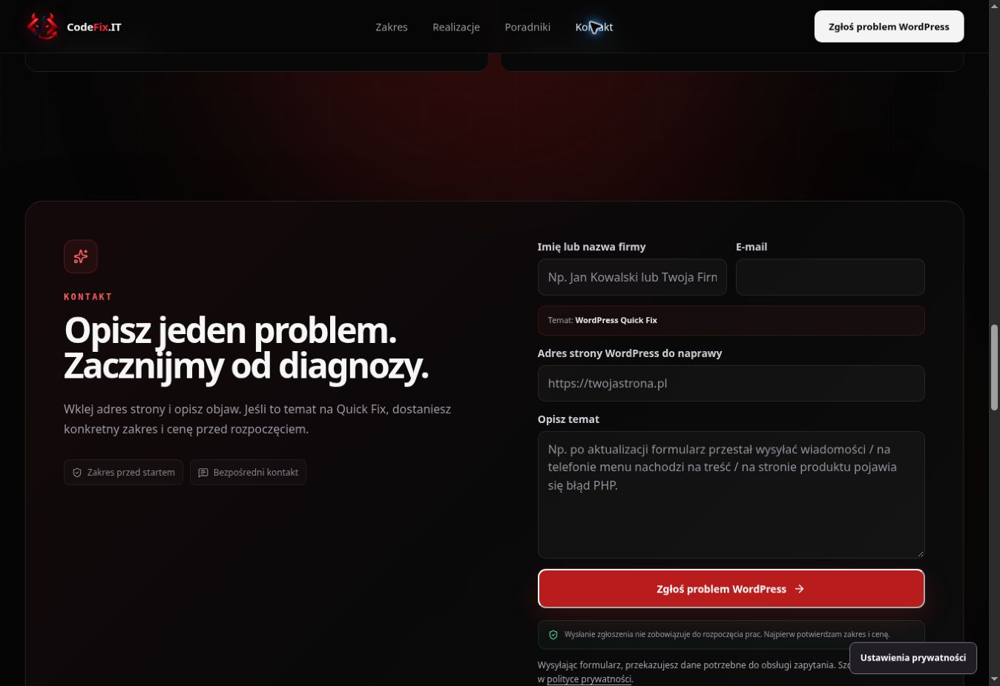

# CodeFix.IT — niezawodność kontaktu, 15.10.2026

Poprawkę opublikowano na https://codefix.it/ 15.10.2026 o 00:57:24 (Europe/Warsaw). PR #92: https://github.com/wwwCodeFixIT/CodeFix.IT---Portfolio-Short/pull/92.

## Co poprawiono

Awaria opcjonalnego SDK pomiarów mogła zatrzymać wysyłkę lub pokazać błąd po przyjęciu zapytania przez CRM. Wspólny emiter izoluje wyjątki SDK przy zachowaniu dotychczasowych warunków zgody. Konwersja wymaga leadId z CRM; duplikaty i odpowiedź antyspamu 202 bez zapisanego leada nie są liczone.

Oba formularze używają wspólnego odczytu odpowiedzi serwera. Błąd JSON dostaje czytelny komunikat, a wpisane dane pozostają. Formularz usług przenosi fokus na wynik, ogłasza błąd przez alert i blokuje ponowny submit podczas wysyłania.

## Sprawdzenia

[Contact Submission Audit #4](https://github.com/wwwCodeFixIT/CodeFix.IT---Portfolio-Short/actions/runs/38650621302): **52/52**, po 26 w Chromium i WebKit. Oba formularze: zgody none/analytics/ads/both, duplikat, honeypot 202, błąd API, uszkodzony JSON, awaria sieci oraz SDK rzucające wyjątek przed wysyłką lub po przyjęciu, uszkodzony SDK reklam i brak SDK. Sprawdzono pojedynczy POST, usługę i wiadomość, liczbę konwersji, fokus na wyniku oraz czyszczenie/zachowanie danych. Wszystkie żądania do CRM i pomiarów przechwycono; zero nowych produkcyjnych leadów i rzeczywistych konwersji. Wyniki zapisano w [JSON](qa/contact-submission-20261015.json).

CI #856 na końcowym PR oraz CI #857, SEO Production Smoke #82 i pages build/deployment #103 na dokładnym merge SHA: success. Kontrole lokalne obejmowały typecheck, lint, lint produkcji, format, build/prerender, statyczne SEO, measurement smoke i budżety.

Produkcja: strona główna i Quick Fix — HTTP 200, entry `/assets/index-Djqx0thH.js`, brak X-Robots-Tag noindex. Główne i odroczone pliki kontaktu pobierają się poprawnie. W przeglądarce potwierdzono tę samą wersję, dostępny formularz i brak przewijania poziomego. Produkcyjny preflight API — 204 z prawidłowym Origin, POST i Content-Type.

Odczyt CRM potwierdził dokładnie jedno wcześniejsze zgłoszenie „TEST QA CodeFix.IT” z 14.10.2026, poprawny service=development, CTA hero_path_application, submitPath=/ i wysłane powiadomienie. Nie wysyłano ponownie zgłoszenia ani powiadomienia w ramach tego etapu.

| Zasób | Rozmiar | Limit |
| --- | ---: | ---: |
| Entry JS | 200803 B | 215000 B |
| Największy deferred JS | 45391 B | 50000 B |
| Łączny JS | 311341 B | 320000 B |
| Największy CSS | 33884 B | 40000 B |
| Łączny CSS | 69711 B | 70000 B |

## Wersja i zakres

- Końcowy head PR: `5f95cc7b7cc7234362696c6b81ad2c66842600cc`.
- Merge produkcyjny: `dc55e7d3519bafe5aae5d4d49020982f47f2c780`.
- Drzewo produkcji: `61832698be57c4e87bac4422521a2f864a9e5781`, identyczne z końcowym PR.
- Poprzedni main jako punkt odniesienia w razie potrzeby cofnięcia: `d59e7b452faa68655b6fc21341e6dac34e3c017b`.
- Backend i payload leadów, wygląd, ceny, zgody i identyfikatory pomiarów zachowano. Bez nowych zależności aplikacji.
- WebKit w CI nie zastępuje testu klawiatury na fizycznym iPhonie; ten test pozostaje niepotwierdzony. Nie wykonywano nowego pomiaru Lighthouse.

Raport i zrzut zapisano na gałęzi reports/production-20261015, bez dodatkowej zmiany produkcji.

