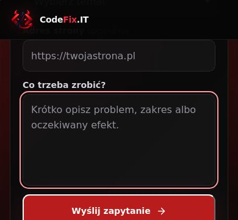
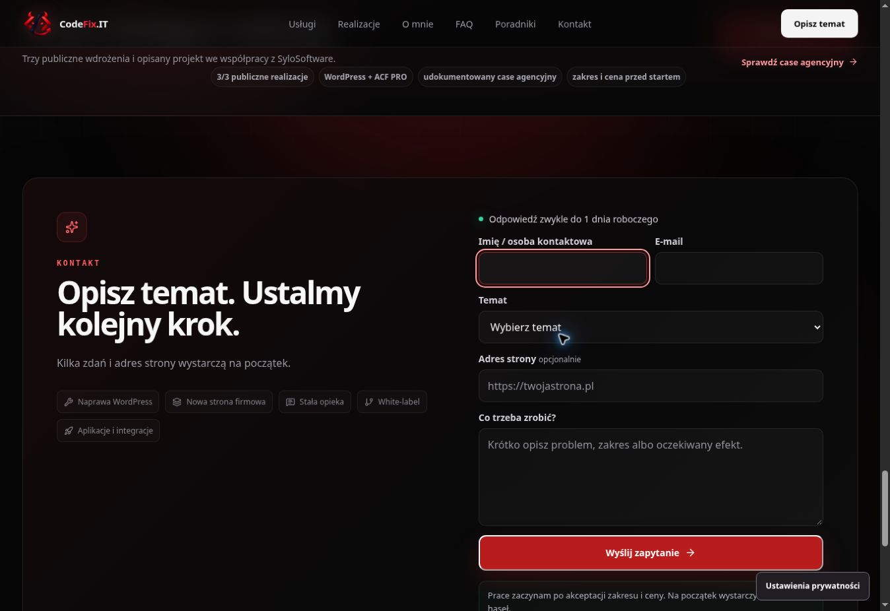

# CodeFix.IT — formularz przy zmianie wysokości ekranu, 14.10.2026

Kod e922209ddcd3546f418723b7b2a8a246f48ca0ae przeszedł CI #844 oraz Contact Viewport Audit #2. Wynik: **8/8 nowych przypadków zmiany wysokości**, **12/12 dotychczasowych scenariuszy mobilnych** i pięć pomiarów Lighthouse. Zmiany są w podglądzie; PR #91 nadal jest szkicem przed publikacją produkcyjną.

Sprawdzone niezmienne wdrożenie: https://0bf7e9a6.codefix-it---portfolio-short.pages.dev/. Entry: /assets/index-CQajBJcS.js. Podgląd gałęzi: https://feat-project-estimator-v1.codefix-it---portfolio-short.pages.dev/#contact.

## Problem i poprawka

Przy wysokości 844 px pole imienia miało dolną krawędź na ok. 448 px. Po zmniejszeniu wysokości do 360 lub 430 px pozostawało w tej samej pozycji i wychodziło poza viewport. Test odtworzył problem w ośmiu przypadkach Chromium i WebKit.

Formularz reaguje teraz na visualViewport.resize. Po klatce renderowania przewija stronę tylko o odległość potrzebną, aby aktywne pole formularza było widoczne pomiędzy nagłówkiem a dolną krawędzią viewportu, z marginesem 8 px. Obsługa dotyczy pól input/textarea sekcji kontaktu na szerokościach do 720 px.

Nie koryguje przewinięcia podczas zoomu ani dla pola wyższego od dostępnej przestrzeni — wtedy widoczność kursora obsługuje przeglądarka. Efekt usuwa listener i zaplanowaną klatkę przy odmontowaniu. Endpoint, payload, obsługa odpowiedzi formularza, treść i wygląd pozostają zgodne z wcześniejszym etapem.

## Zakres testu

Playwright 1.64.0, Chromium/Google Chrome 155.0.8059.39 i WebKit 27.2, Ubuntu 24.04. Osiem świeżych kontekstów: dwa silniki × szerokości 320/390 px × wysokości 360/430 px, start przy wysokości 844 px.

Każdy scenariusz sprawdza:

1. CTA „Opisz temat” i widoczne aktywne pole imienia.
2. Zmniejszenie viewportu i dalszą widoczność imienia.
3. Przejście do e-maila i opisu, bez zasłonięcia pola przez nagłówek.
4. Przywrócenie wysokości 844 px, zachowany focus i brak poziomego przepełnienia.

Po poprawce dolna krawędź imienia jest na ok. **352 px dla wysokości 360 px** oraz **422 px dla 430 px**. Wszystkie osiem przypadków przechodzi; nie było błędów JS ani żądań wysłania leada.

Powtórzono 12 dotychczasowych scenariuszy Chromium/WebKit: pięć szerokości 320/375/390/430/768 px dla obu silników, dodatkowo ograniczony ruch. Przy 375 px sprawdzono też kalkulator, przeniesienie zakresu, zachowanie notatki, ustawienia prywatności z powrotem focusu oraz portfolio → formularz. Wszystkie przechodzą; brak błędów JS i żądań leada.

Chrome w otwartym podglądzie potwierdził aktualny entry, focus na imieniu, widoczne pole i brak poziomego przepełnienia.

## Lighthouse na zmienionym kodzie

Lighthouse 13.5.0: trzy pomiary mobile strony głównej, jeden desktop i mobile strony naprawy. Wynik mediany wydajności strony głównej: **99/100**, zakres **92–99**. Nie traktuję różnic między próbami jako dowodu przyspieszenia przez tę poprawkę.

| Pomiar            | Wydajność | Dostępność | Best practices | SEO | LCP ms | TBT ms | CLS |
| ----------------- | --------: | ---------: | -------------: | --: | -----: | -----: | --: |
| Główna — mobile 1 |        99 |        100 |            100 |  69 |    979 |    148 |   0 |
| Główna — mobile 2 |        92 |        100 |            100 |  69 |   2624 |     20 |   0 |
| Główna — mobile 3 |        99 |        100 |            100 |  69 |   1618 |     23 |   0 |
| Główna — desktop  |       100 |        100 |            100 |  69 |    435 |      0 |   0 |
| Naprawa — mobile  |        96 |        100 |            100 |  66 |   2765 |     32 |   0 |

Brak ostrzeżeń wykonania. SEO 69/66 wynika z celowego noindex podglądu. Są to pomiary laboratoryjne, nie CWV rzeczywistych użytkowników; wynik dostępności 100/100 nie zastępuje pełnej kontroli ręcznej.

## Build i źródła

CI #844: typecheck, lint, production lint, format, build/prerender, SEO (20 stron, 101 linków, 6 kotwic), measurement consent, estimator, hero motion, mobile CTA i budżety — PASS. Bez nowych zależności aplikacji i podnoszenia limitów.

| Zasób                  |  Rozmiar |    Limit |
| ---------------------- | -------: | -------: |
| Entry JS               | 200739 B | 215000 B |
| Największy deferred JS |  45403 B |  50000 B |
| Łączny JS              | 310811 B | 320000 B |
| Największy CSS         |  33884 B |  40000 B |
| Łączny CSS             |  69711 B |  70000 B |

[Przed poprawką](qa/contact-viewport-before-20261014.json), [po poprawce](qa/contact-viewport-after-20261014.json), [12 scenariuszy mobile](qa/mobile-viewport-fix-20261014.json), [Lighthouse](qa/lighthouse-viewport-fix-20261014.json).

[Audit #2](https://github.com/wwwCodeFixIT/CodeFix.IT---Portfolio-Short/actions/runs/38622017019), [CI #844](https://github.com/wwwCodeFixIT/CodeFix.IT---Portfolio-Short/actions/runs/38622017018). Pełne artefakty HTML/JSON i zdjęcia mają retencję do 28.10.2026. Ręczne workflow wskazują niezmienny podgląd i zweryfikowany entry.

SHA-256 pobranych ZIP:

- przed poprawką: df39ec93f2e43a6fc06fc74ee03b35991f92b2139c6b129cf6404e526880b2d3
- po poprawce + mobile: a2128d5df006965d8422e562656e32f6403e117a07598f6e0da4c2c091d58c00
- Lighthouse: 7cd1b5acf4158d7885748cd91d06f1781bfd8a314c377659582ee5dabc13b53b

Pierwszy run zakończył się statusem cancelled przy limicie 8 min, ale zapisał artefakt zawierający wszystkie osiem wyników FAIL. Końcowy run ma oba zadania success; limit uwzględnia przygotowanie środowiska testowego.

## Fizyczny iPhone — wynik nadal oczekiwany

Test zmienia oba viewporty przez page.setViewportSize. Odtwarza problem zmiany geometrii, ale nie emuluje rzeczywistej klawiatury iPhone'a, która może zmniejszać sam visual viewport. Zachowanie na fizycznym urządzeniu wymaga osobnego potwierdzenia.

Otwórz podgląd na iPhonie i dotknij kolejno imienia, e-maila i opisu. Sprawdź widoczność aktywnego pola i możliwość przewijania, następnie zamknij klawiaturę i otwórz ustawienia prywatności w stopce. Wystarczy ten test interfejsu — nie wymaga wysłania formularza.

Źródła metody: [VisualViewport](https://developer.mozilla.org/en-US/docs/Web/API/VisualViewport), [zachowanie viewportów przy klawiaturze](https://developer.chrome.com/blog/viewport-resize-behavior/), [Playwright page.setViewportSize](https://playwright.dev/docs/api/class-page#page-set-viewport-size).
