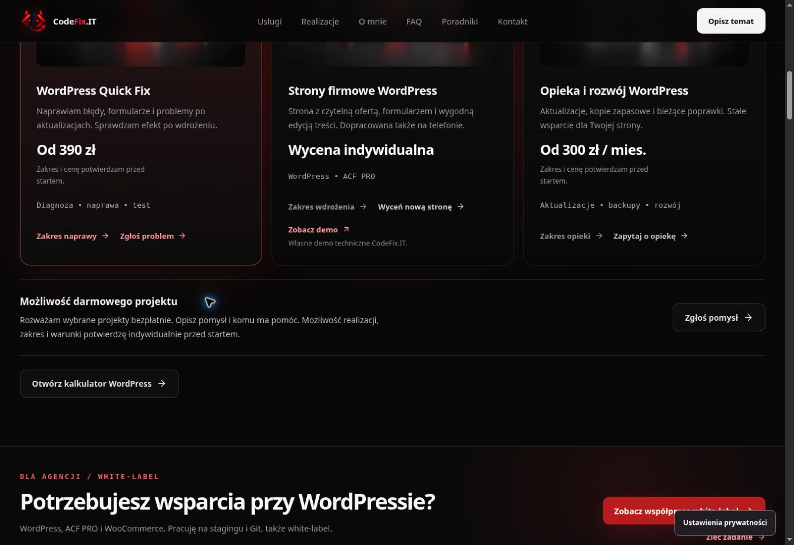
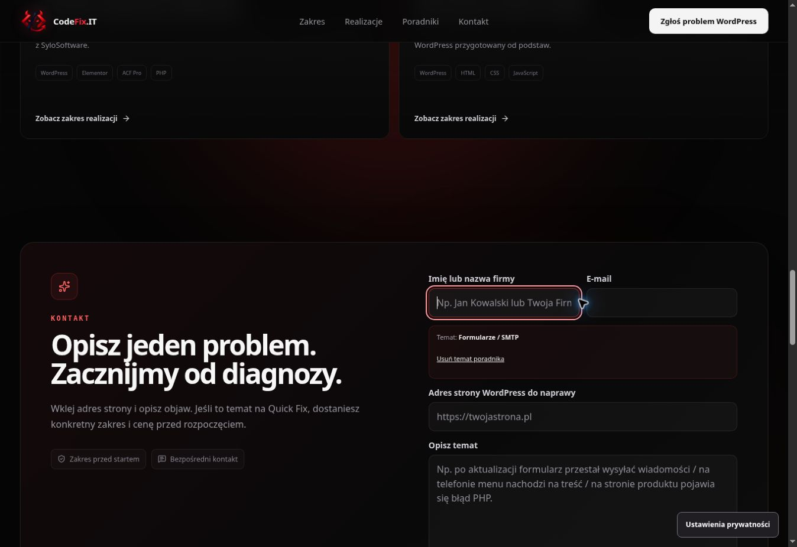

# Kontekst poradnika i możliwość darmowego projektu — produkcja

Data: 16.10.2026. Status: opublikowane i zweryfikowane na https://codefix.it/.

PR [#104](https://github.com/wwwCodeFixIT/CodeFix.IT---Portfolio-Short/pull/104). Produkcja: `7d10adef3bba9ff4240e781064ae6c19a613d96e`. Drzewo produkcji `0f1e1dc3a1c20f3ba37320e771c7bd03a243b3c9` jest identyczne z drzewem kandydata testowanego w CI (`96b76cd7af705cdb0cf191fbf6da024c3a3d5609`).

## Co działa

Po przejściu z jednego z 9 poradników formularz właściwej usługi pokazuje temat i krótkie pytania pomocnicze. Dopasowanie wymaga znanego poradnika oraz zgodnej trasy usługi. Podpowiedź i błąd walidacji są połączone z polem przez `aria-describedby`. Formularz nie wpisuje automatycznie tekstu w opis klienta.

„Usuń temat poradnika” ukrywa temat i podpowiedź, zachowuje wiadomość oraz źródło wizyty i przenosi fokus do opisu. Przyciski kontaktu rozwiązują wysokości odroczonych sekcji przed ustawieniem fokusu i przewinięciem. Naprawia to zatrzymywanie przewijania nad formularzem w mobilnym WebKit. Fragment URL i istniejący pomiar kliknięć pozostają aktywne.

Pod usługami pojawiła się krótka informacja:

> **Możliwość darmowego projektu**
>
> Rozważam wybrane projekty bezpłatnie. Opisz pomysł i komu ma pomóc. Możliwość realizacji, zakres i warunki potwierdzę indywidualnie przed startem.

„Zgłoś pomysł” otwiera szczegóły istniejącego formularza z opcjonalnie zaznaczoną prośbą. Klient może ją odznaczyć. Podsumowanie i kopiowany brief pokazują aktualny wybór. Zgłoszenie korzysta z istniejącego `service: other`; do `message` trafia „Prośba o rozważenie darmowego projektu.”. Limit 4000 znaków uwzględnia to uzupełnienie. Sukces i zmiana tematu czyszczą wybór, błąd zachowuje dane. Oferta nie gwarantuje przyjęcia każdego zgłoszenia. Statyczny HTML zawiera tę samą treść oraz kontakt e-mail.

## Weryfikacja

Pełny [Contact Submission Audit #47](https://github.com/wwwCodeFixIT/CodeFix.IT---Portfolio-Short/actions/runs/38884605755): **152 scenariusze PASS, 114 przechwyconych żądań, 0 rzeczywistych zgłoszeń**. Chromium i WebKit; nowe przepływy przy szerokościach 320/390/1280 px i obu preferencjach ruchu.

| Obszar | Scenariusze |
| --- | ---: |
| Kontekst formularza i darmowy projekt | 12 |
| Nawigacja poradników | 12 + 2 bez JS |
| Wyszukiwarka poradników | 12 + 2 bez JS |
| Podgląd realizacji | 12 |
| Formularz krok po kroku | 12 |
| Wysyłanie, walidacja i błędy | 52 |
| Ścieżki wszystkich poradników i realizacji | 24 |
| Przykłady automatyzacji | 12 |

Nowe przypadki sprawdzają m.in. podpowiedź razem z walidacją, brak nadpisania opisu, zachowanie danych po 503, usuwanie tematu, fokus, opcjonalność darmowego projektu, podsumowanie, payload, reset, UTM i brak poziomego przewijania. Wszystkie 9 podpowiedzi sprawdzono w obu silnikach.

CI kandydata #959/#960 i CI produkcji #961: PASS. Typy, lint, format, budowa, kontrakty pomiaru i kalkulatora oraz limity zasobów przeszły. Statyczne SEO: 20 stron, 143 linki wewnętrzne, 48 kotwic. [SEO Production Smoke #96](https://github.com/wwwCodeFixIT/CodeFix.IT---Portfolio-Short/actions/runs/38910317854): 20 stron HTTP 200, indeksowalność, meta, canonical, schema i statyczny HTML — PASS. Cloudflare Pages oraz pages build and deployment #115 — PASS.

Ręcznie na produkcji potwierdzono treść oferty, przejście do kroku 2/3, odznaczenie i ponowne zaznaczenie prośby klawiszem Space, oba warianty podsumowania, temat SMTP, podpowiedź, fokus oraz zachowanie opisu po usunięciu tematu. Nie wysyłano formularza produkcyjnego. Jedna próba odznaczenia przez CUA tuż po wypełnieniu pola nie zmieniła stanu; po obserwacji użyto klawiatury. Standardowe testy kliknięcia Playwright przeszły we wszystkich 12 kombinacjach.

## Zasoby

Runtime produkcji: `/assets/index-DxaB69cA.js`. Bez nowych zależności i nowego API.

| Zasób | Wynik | Limit |
| --- | ---: | ---: |
| Wejściowy JS | 202191 B | 215000 B |
| Największy odroczony JS | 50552 B | 51000 B |
| Cały JS | 332735 B | 333000 B |
| Największy CSS | 38823 B | 40000 B |
| Cały CSS | 80586 B | 81000 B |

Przyrost wobec poprzedniej produkcji: 2955 B JS i 827 B CSS. Jawne zmiany limitów: suma JS 330000 → 333000 B, suma CSS 80000 → 81000 B, największy odroczony JS 50000 → 51000 B. Nowego pomiaru Lighthouse ani danych CWV z ruchu rzeczywistego w tym etapie nie wykonywano.

## Dowody

Pełne przypadki, identyfikatory kontroli i hashe zrzutów: [guide-contact-free-project-20261016.json](qa/guide-contact-free-project-20261016.json). Dokumentację zachowano na gałęzi `reports/guide-contact-free-project-20261016`; nie zmienia ona publikowanego kodu. Zachowano również trzy pliki dowodowe poprzedniego etapu nawigacji poradników.
