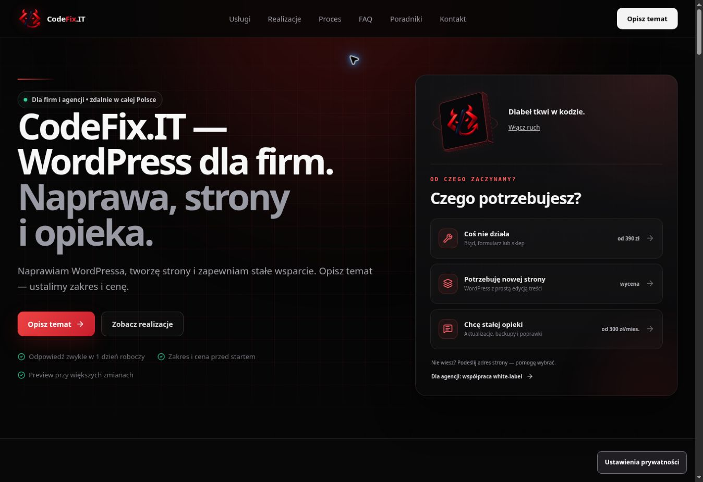

# CodeFix.IT — obecny układ z dodatkami interaktywnymi

> Ten dokument opisuje bazę układu z `61e0878`. Aktualną wersję jednoosobową, widoczne interakcje i poprawki czytelności opisuje [agency-home-v1](agency-home-v1.md).

Bazą jest strona produkcyjna `https://codefix.it/`, obejrzana 14.10.2026, i odpowiadający jej `main` na `780420a`. Wersja w PR #91 zachowuje pełne menu, panel wyboru usługi w hero, ilustracje usług, podglądy realizacji, sekcje dla agencji i firm, proces, FAQ, kontakt oraz stopkę.

Wprowadzono krótszy nagłówek, opisy usług i pozostałych sekcji. Usunięto powtarzającą ofertę linię nad H1. Treści hero, usług, procesu i ośmiu pytań FAQ są wspólne dla React i statycznego HTML; FAQ schema odzwierciedla widoczne odpowiedzi. Nie zmieniono treści usług i case studies na ich własnych podstronach.

Znak 3D pozostaje dodatkiem do istniejącego panelu. Unosi się i delikatnie reaguje na mysz; siatka tła porusza się powoli, a światło podąża za wskaźnikiem. Przycisk zatrzymuje ruch. Dotyk i ograniczenie ruchu mają wariant statyczny; hero poza ekranem i ukryta karta wyłączają animacje.

Kalkulator rozwija się jednym przyciskiem pod kartami usług. Kod, CSS i cennik są ładowane na żądanie, odpowiedzi pozostają po zwinięciu. Zakres trafia do dotychczasowego formularza bez utraty własnych uwag. Nie dodano zależności ani nowych zdarzeń konwersji. Obecne stawki, identyfikatory usług, CRM, zgody i atrybucja zachowują swoją logikę.

## Walidacja lokalna

PASS: typecheck, lint, production lint, format, czysty build i prerender, estimator smoke, hero motion smoke, measurement-consent smoke, mobile CTA source smoke, build budgets i diff check. Porównanie AST potwierdza niezmienioną strukturę handlerów CRM, wyboru usługi, przekazania i usunięcia briefu oraz startu formularza. Statyczny H1, canonical i osiem odpowiedzi FAQ sprawdzono względem katalogu treści.

| Zasób | Rozmiar | Limit |
| --- | ---: | ---: |
| Entry JS | 200739 B | 215000 B |
| Największy deferred JS | 42183 B | 50000 B |
| Łączny JS | 307658 B | 320000 B |
| Największy CSS | 34311 B | 40000 B |
| Łączny CSS | 69807 B | 70000 B |

## Kontrola podglądu

Sprawdzono w Chrome przy 1348 × 926 px na podglądzie `61e0878`: `https://6a96f503.codefix-it---portfolio-short.pages.dev/`. Końcowy adres gałęzi: `https://feat-project-estimator-v1.codefix-it---portfolio-short.pages.dev/`. CI i Cloudflare deployment dla tej zmiany: success.

PASS w przeglądarce: sześć linków menu, jedenaście sekcji głównych, jeden H1 i main, język PL, trzy ilustracje usług i trzy podglądy realizacji. Brak poziomego przewijania. Obejrzano hero, usługi, realizacje i FAQ. Link zakresu naprawy otwiera dotychczasową podstronę usługi.

PASS: reakcja na mysz (zaobserwowane 3,69° / −0,81°), pauza Enterem, wznowienie spacją i wyłączenie ruchu poza ekranem. Pauza zeruje zmienne wskaźnika i przełącza `aria-pressed`.

PASS: kalkulator otwiera się Enterem i zachowuje odpowiedzi po zwinięciu. Nowa strona ma wycenę indywidualną i uwzględnia sklep, 6–10 podstron, część materiałów oraz CRM. Quick Fix od 390 zł, wiele problemów z wyceną indywidualną, trzy miesiące opieki od 900 zł, agencja 8–16 h za 960–1920 zł.

PASS: brief trafia do tematu agencyjnego, focus przechodzi do imienia, a własne uwagi pozostają. Usunięcie briefu zachowuje uwagi, przywraca limit 4000 znaków i focus do `message`. FAQ rozwija się Enterem. Nie wysyłano próbnych leadów do produkcyjnego CRM; opcjonalne pomiary odrzucono. Zaobserwowane wpisy błędów konsoli pochodziły z rozszerzenia przeglądarki, bez zauważonego błędu aplikacji.

Poprzednie raporty i zrzuty opisują własne SHA, a dokument `homepage-minimal-v1.md` jest historyczny.

Telefon, dotyk, fizyczny Safari/iPhone, systemowa zmiana ograniczenia ruchu, ukrycie karty, Lighthouse i pełny audyt WCAG wymagają osobnej kontroli. PR pozostaje szkicem; nie wykonano merge ani publikacji na produkcji.
