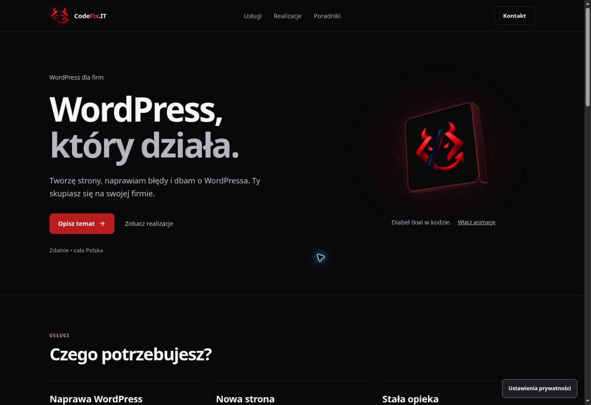

# CodeFix.IT — spokojniejsza strona główna

> Wariant historyczny, zastąpiony 14.10.2026 na prośbę właściciela. Bieżąca wersja zachowuje układ strony produkcyjnej i jest opisana w [home current layout](homepage-current-layout-v1.md).

Strona główna otrzymuje krótszą treść i prostszą hierarchię. Wcześniej zawierała 12 sekcji i 6 linków głównego menu. Nowa wersja ma 5 sekcji i 3 linki menu; kontakt pozostaje wyraźnym przyciskiem.

1. Hero: „WordPress, który działa.”, jedno krótkie wprowadzenie, główne CTA i link do realizacji. Przestrzenny znak marki jest samodzielnym akcentem.
2. Usługi: trzy krótkie opisy, ceny startowe i jeden link zakresu dla każdej usługi. Kalkulator jest zwinięty pod przyciskiem; współpraca agencyjna prowadzi do własnej podstrony.
3. Realizacje: trzy podglądy i nazwy projektów. Współpraca z SyloSoftware pozostaje oznaczona; szczegóły są w case studies.
4. Współpraca: trzy zwięzłe kroki i trzy zwijane pytania.
5. Kontakt: opis, formularz i e-mail. Stopka zawiera tylko podstawowe linki.

Usunięto powtórzony wybór usługi w hero, wielokrotne bloki wiarygodności, rozbudowane opisy tych samych usług i osobne pasy dodatkowych CTA. Karty usług nie pobierają dekoracyjnych ilustracji. Zmniejszono nasycenie tła i usunięto nadmiar ramek oraz poświat.

Treść główna pochodzi z `src/data/homepage-content.json`. Statyczny HTML i FAQ schema korzystają z tego samego źródła. Canonical, metadane, adresy usług, treści poradników i case studies są zachowane.

Styl wariantu jest ograniczony do `.cf-home-minimal`; współdzielone arkusze oczyszczono wyłącznie z selektorów usuniętych elementów strony głównej. Osobne strony usług i poradników zachowują swój układ.

Obsługa wysyłania do CRM, atrybucji, zgód i dołączania/usuwania briefu zachowuje dotychczasową logikę. Pola mają etykiety, focus jest widoczny, a wymiary obrazów rezerwują miejsce. Pauza animacji, wariant dotykowy i `prefers-reduced-motion` pozostają dostępne. Nie dodano zależności.

Walidacja lokalna: typecheck, lint, production lint, format, build/prerender, hero motion smoke, estimator smoke, measurement-consent smoke, mobile CTA source smoke i build budgets. Strukturalne porównanie handlerów przed/po: bez zmian w obsłudze CRM i briefu.

Przegląd nowego podglądu, aktualne rozmiary paczek i wyniki kontroli przeglądarkowej są dokumentowane w opisie PR #91. Wcześniejsze wyniki `interactive-preview-qa-v1.md` dotyczą wcześniejszych SHA, przed uproszczeniem wyglądu.

Do kontroli przed publikacją pozostają również telefon, systemowe ograniczenie ruchu, Safari/iPhone, Lighthouse i pełny audyt WCAG. PR pozostaje szkicem.

## Wyniki podglądu — 14.10.2026

Sprawdzono Chrome przy 1348 × 936 px. Końcowy wygląd zweryfikowano na `aba3781`, podgląd `https://23ed5af8.codefix-it---portfolio-short.pages.dev/`.

PASS: pięć sekcji, trzy linki menu, jeden H1, jeden `main`, język PL i poziome przewijanie 0 px. Hero oraz usługi są czytelne; zniknęła duża poświata wspólnego tła.

PASS w przeglądarce: pauza hero klawiaturą, otwarcie kalkulatora Enterem, zachowanie wybranej puli po zwinięciu, Quick Fix od 390 zł, agencja 8–16 godzin za 960–1920 zł, przekazanie briefu do właściwego tematu oraz zachowanie własnych uwag. Po usunięciu briefu focus wraca do `message`, a limit opisu do 4000 znaków. FAQ otwiera się Enterem. Link zakresu prowadzi do podstrony naprawy; jej istniejący układ został obejrzany. Nie wysyłano próbnych zgłoszeń do CRM.

CI i Cloudflare preview na `aba3781`: success. Pozostałe kontrole wymienione wyżej nie były wykonywane i nie są oznaczone jako PASS.

| Zasób                  | Przed uproszczeniem |       Po |    Limit |
| ---------------------- | ------------------: | -------: | -------: |
| Łączny JS              |            310165 B | 292912 B | 320000 B |
| Największy deferred JS |             44690 B |  27525 B |  50000 B |
| Łączny CSS             |             69988 B |  63510 B |  70000 B |

Obliczony kontrast głównego przycisku: biały na `#b91c1c` — 6,47:1; hover — 5,66:1. Główna przygaszona treść `#aaaab3` na `#08080a` — 8,68:1. To sprawdzenie kolorów, nie pełny audyt WCAG.
