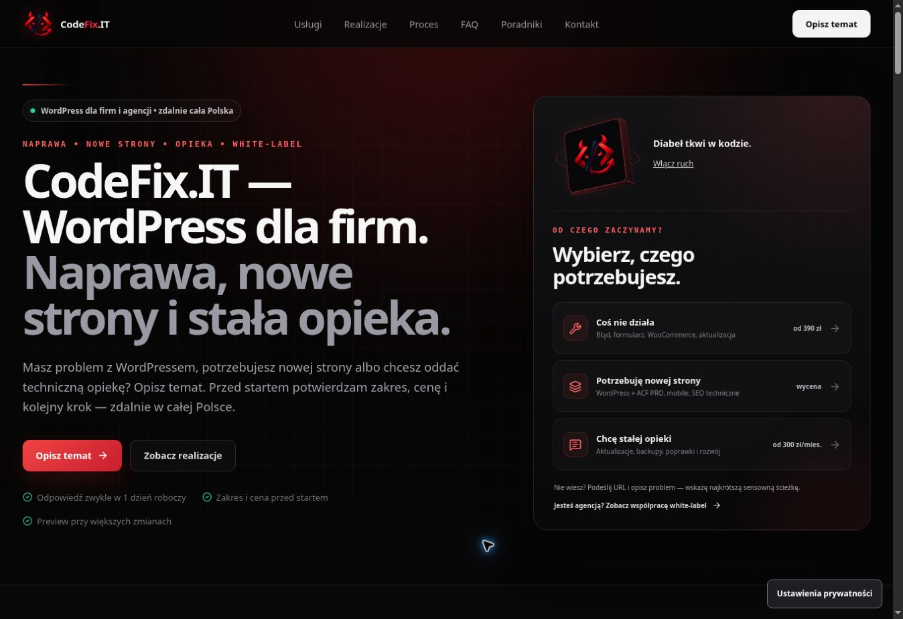

# CodeFix.IT — kontrola podglądu interaktywnego hero i kalkulatora

Data: 14.10.2026 (Europe/Warsaw). PR: #91, gałąź `feat/project-estimator-v1`.

Kontrola odbyła się w rzeczywistej przeglądarce Chrome na podglądzie Cloudflare Pages, przy obszarze strony 1348 × 936 px. Pełny zakres desktop sprawdzono dla `191d1d3`; regresję focusu po poprawce sprawdzono dla `3701131` na `https://079827e8.codefix-it---portfolio-short.pages.dev/`.

## Wyniki w przeglądarce

| Kontrola                     | Wynik | Zaobserwowane zachowanie                                                                                                                     |
| ---------------------------- | ----- | -------------------------------------------------------------------------------------------------------------------------------------------- |
| Układ hero na desktopie      | PASS  | Znak przestrzenny i oferta są czytelne; brak poziomego przewijania.                                                                          |
| Reakcja na mysz              | PASS  | Po ruchu myszy zmieniają się kąty i położenie światła; obserwowane kąty 1,83° i 5,70° mieszczą się w granicach.                              |
| Pauza i wznowienie           | PASS  | Przycisk zmienia `aria-pressed`; pauza ustawia `data-motion="off"` i zeruje zmienne wskaźnika. Wznowienie działa spacją i ma widoczny focus. |
| Hero poza viewportem         | PASS  | Po przewinięciu do kalkulatora `data-motion="off"`; zmienne wskaźnika są wyzerowane.                                                         |
| Struktura strony             | PASS  | Jeden `main`, jeden H1, `lang="pl"`, poziome przewijanie 0 px.                                                                               |
| Nowa strona                  | PASS  | Sklep WooCommerce, 6–10 podstron, część materiałów, dodatkowy język i CRM pojawiają się w podsumowaniu; wycena pozostaje indywidualna.       |
| Zachowanie odpowiedzi        | PASS  | Zwinięcie i ponowne otwarcie Enterem zachowuje ustawienia i dodatkowe funkcje.                                                               |
| Quick Fix                    | PASS  | Pojedynczy problem: od 390 zł. Kilka problemów: wycena indywidualna.                                                                         |
| Stała opieka                 | PASS  | Cena startowa 300 zł/mies.; trzy miesiące: od 900 zł / 3 mies.                                                                               |
| Agencja                      | PASS  | Stawka 120 zł/h; 8–16 godzin: 960–1920 zł.                                                                                                   |
| Przeniesienie briefu         | PASS  | Enter dołącza widoczny zakres, wybiera temat, przenosi focus do imienia; własne uwagi pozostają w formularzu.                                |
| Limit wiadomości             | PASS  | Dla sprawdzonego briefu agencyjnego limit własnego opisu wynosił 3750 znaków; po usunięciu zakresu wrócił do 4000.                           |
| Usunięcie briefu po poprawce | PASS  | Zakres znika, własne uwagi pozostają; focus trafia do pola opisu.                                                                            |
| Zmiana tematu                | PASS  | Zmiana na opiekę usuwa brief, zachowuje opis i przywraca limit 4000 znaków.                                                                  |
| Podstrony usług              | PASS  | Linki prowadzą do naprawy, nowych stron, opieki i white-label; każda pokazuje właściwy H1.                                                   |

Nie wysyłano formularzy do produkcyjnego CRM. Opcjonalne pomiary odrzucono w banerze zgód. Konsola pokazała błąd rozszerzenia przeglądarki, bez zaobserwowanego błędu aplikacji.

## Poprawka po kontroli

Przed poprawką usunięcie dołączonego zakresu usuwało również aktywny przycisk, przez co focus przechodził do dokumentu. Handler `removeProjectBrief` po aktualizacji formularza ustawia focus na istniejącym polu `message` z `preventScroll: true`. Weryfikacja klawiaturą na wdrożeniu `3701131`: PASS, bez utraty treści pola.

## Walidacja automatyczna poprawki

PASS: typecheck, lint, production lint, format check, build i prerender, estimator smoke, hero motion smoke, measurement-consent smoke, mobile CTA **source** smoke, build budgets, `git diff --check`. CI na `3701131`: success. Cloudflare preview: deploy successful.

| Zasób                  |  Rozmiar |    Limit |
| ---------------------- | -------: | -------: |
| Entry JS               | 200739 B | 215000 B |
| Największy deferred JS |  44690 B |  50000 B |
| Łączny JS              | 310165 B | 320000 B |
| Największy CSS         |  34463 B |  40000 B |
| Łączny CSS             |  69988 B |  70000 B |

## Pozostałe kontrole

NOT RUN: widoki 390/1440 px, emulacja dotyku, zmiana systemowej preferencji `prefers-reduced-motion`, wyłączenie ruchu przy ukrytej karcie, fizyczny Safari/iPhone, Lighthouse i pełny audyt WCAG. Dostępna kontrola przeglądarki nie udostępnia ustawienia viewportu ani emulacji preferencji; skróty DevTools nie uruchomiły trybu mobilnego. Test kodu mobile CTA nie zastępuje kontroli w telefonie.

PR pozostaje szkicem; nie wykonano merge ani publikacji na produkcji.
