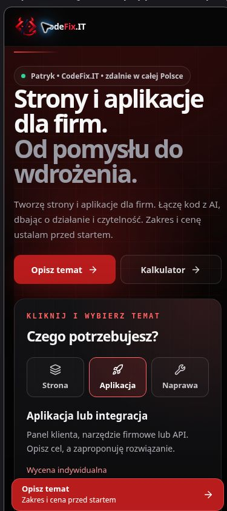
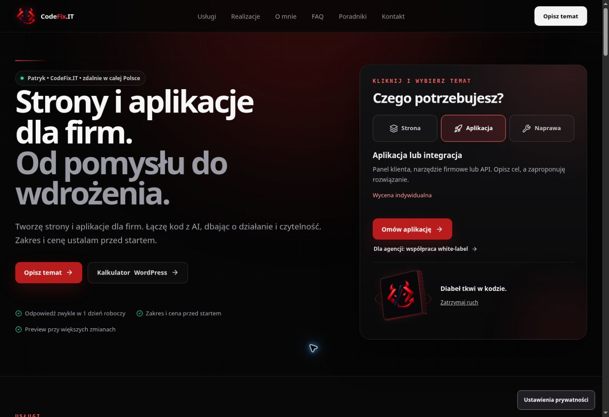

# CodeFix.IT — kontrola mobilnego pierwszego ekranu

Celem jest wcześniejsza widoczność przycisków Strona / Aplikacja / Naprawa i wygodny dostęp do kalkulatora przy zachowaniu bieżącej oferty, jednoosobowej treści i identyfikacji CodeFix.IT.

## Zmiany

- Informacje o standardzie pracy są za panelem wyboru w kolejności DOM. Desktop układa te same elementy w dotychczasowych dwóch kolumnach.
- Znak 3D znajduje się pod wyborem i CTA; na małym ekranie ma mniejszy rozmiar.
- Nagłówek mobilny jest odrobinę mniejszy, a dwa przyciski mieszczą się w jednym rzędzie. Pełna nazwa kalkulatora pozostaje nazwą dostępną.
- Na telefonie zdublowany pływający przycisk prywatności ustępuje temu samemu działającemu przyciskowi w stopce; opisy pozostają czytelne. Banner i wybory pomiarów zachowują swoją logikę.
- Panel przycina tło przez `overflow: clip`. Dekoracyjna poświata poza jego dolną krawędzią wcześniej tworzyła zakres przewijania: focus na CTA przesuwał wewnętrzną zawartość o 94 px. Po powrocie ucięty był nagłówek. Po poprawce panel zachowuje `scrollTop=0`, a nagłówek pozostaje w karcie.
- Focus obu głównych przycisków ma ten sam widoczny obrys. Usunięto nadpisane i zbędne deklaracje CSS, aby zachować limity.

## Metoda

Kontrola odbywa się w Chrome na samodzielnym dokumencie QA uruchamiającym te same skompilowane moduły i arkusze co podgląd. Jego obszar strony ma zadaną szerokość. Nie jest to emulator sprzętu, dotyku ani Safari. Wysyłka formularza i opcjonalne pomiary są wyłączone w dokumencie QA. Nagłówki bezpieczeństwa strony nie są zmieniane. Tymczasowy plik QA usunięto z końcowej wersji PR.

Początkowy widok nominalnie 390 px miał 388 px obszaru dokumentu z powodu obramowania ramki. Wybór usług zaczynał się na 899 px. W nominalnym widoku 320 px dokument miał 318 px: 2 px przewijania wynikały z minimalnej szerokości strony 320 px, a nie z elementu wychodzącego poza prawidłowy viewport 320 px. Obramowanie ramki zastąpiono obrysem, żeby dalsze pomiary miały dokładną szerokość.

## Sprawdzenia lokalne

PASS: typecheck, lint, production lint, format, czysty build/prerender, budżety, estimator, hero motion, measurement consent, mobile CTA source smoke i diff check. Teksty, SEO, ceny, formularz CRM i dziewięć poradników zachowują wcześniejszą logikę.

Rozmiary: entry JS 200739 B, największy deferred JS 43999 B, łączny JS 309474 B, największy CSS 33782 B, łączny CSS 69609 B. Limity nie są zmieniane.

## Kontrola podglądu

PASS na `653ad16`, wdrożenie https://74ca4771.codefix-it---portfolio-short.pages.dev/. CI #815 i Cloudflare: success. Wysokość obszaru QA: 844 px.

| Szerokość CSS | Góra wyboru usług | Dół wyboru usług | Poziome przewijanie | Scroll panelu |
| --- | ---: | ---: | ---: | ---: |
| 320 px | 620 px | 686 px | 0 px | 0 px |
| 375 px | 578 px | 644 px | 0 px | 0 px |
| 390 px | 585 px | 651 px | 0 px | 0 px |
| 430 px | 602 px | 669 px | 0 px | 0 px |
| 768 px | 577 px | 637 px | 0 px | 0 px |

Przy każdej szerokości nagłówek panelu pozostaje wewnątrz karty. Przejście Enterem z aplikacji do formularza i powrót do góry po poprawce przycinania nie przesuwają zawartości panelu. Główne CTA mają 48 px, przyciski wyboru na telefonie około 67 px wysokości.

PASS przy 375 px: wybór aplikacji, właściwy identyfikator `development`, pole firmy i focus na imieniu; ukrycie sticky CTA podczas focusu w formularzu. Pola formularza mają 16 px i 52 px wysokości, textarea 150 px. Kalkulator ma kontrolki 16 px, działa w jednej kolumnie, daje od 900 zł za 3 miesiące opieki, przekazuje zakres i `WORDPRESS_CARE`, zachowuje własne uwagi i przekazuje focus. Po usunięciu zakresu focus wraca do opisu. W tym etapie nie wysłano nowego zgłoszenia do CRM.

PASS: ustawienia prywatności ze stopki otwierają panel z focusem; odrzucenie zamyka go i wraca do przycisku. Sprawdzono to także na świeżej, rzeczywistej stronie podglądu z oryginalnym bootstrapem pomiarów. Widok desktop zachowuje dwie kolumny, czytelne informacje, działający wybór i znak 3D.

PR #91 pozostaje szkicem bez merge i publikacji produkcyjnej. Fizyczny iPhone/Safari i realne CWV nie są potwierdzone tym testem. Końcowy commit porządkowy usuwa samodzielny dokument QA i zapisuje raport oraz zrzuty, bez zmiany sprawdzonego kodu aplikacji.
