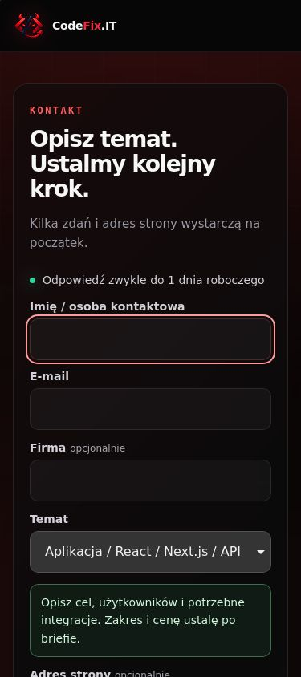
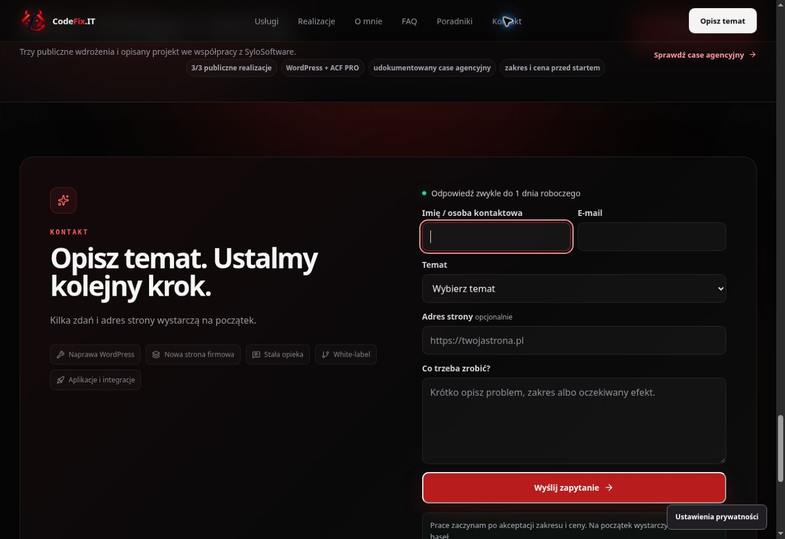

# CodeFix.IT — wydajność i testy mobilne, 14.10.2026

Aktualizacja: nowszy kod, testy zmiany wysokości ekranu i ponowne pomiary są w [contact-viewport-v1](contact-viewport-v1.md). Poniższe wyniki dotyczą wcześniejszego kodu eff52f9.

Końcowy kod eff52f9e298a9fdfc311ae1da021b5f91818a35f przeszedł CI #838 oraz oba zadania audytu #6: Lighthouse i 12 scenariuszy Chromium/WebKit. Mediana wydajności strony głównej na mobile wynosi 99/100; desktop 100/100. Podstrona naprawy uzyskała 95/100. Automatyczny wynik dostępności wszystkich pięciu pomiarów: 100/100.

Sprawdzony podgląd: https://320773b5.codefix-it---portfolio-short.pages.dev/. Entry: /assets/index-BxGA2aCr.js. Publiczny podgląd gałęzi: https://feat-project-estimator-v1.codefix-it---portfolio-short.pages.dev/. PR #91 pozostaje szkicem; ten etap nie publikuje zmian na codefix.it.

## Poprawione problemy

- CTA do kontaktu wybierało temat i focus, ale przy odroczonym renderowaniu sekcji kończyło przewinięcie poza formularzem. Wszystkie wejścia do kontaktu na stronie głównej korzystają teraz ze wspólnej obsługi. Na telefonach pole imienia jest centrowane po klatce renderowania z uwzględnieniem visual viewport.
- W WebKit zmiana wysokości odroczonych sekcji po opuszczeniu pola gubiła kliknięcie ustawień prywatności w stopce. Po pierwszym focusie strona utrzymuje rzeczywiste wysokości sekcji do opuszczenia strony. Odroczone renderowanie nadal działa przy początkowym ładowaniu.
- Przycisk ustawień w stopce otrzymuje jawny focus przed otwarciem panelu, aby wracał do niego także po kliknięciu w WebKit.
- Zwiększono kontrast małej etykiety bieżącej strony w nawigacji okruszkowej naprawy: #696970 → #98989f. Footer marki używa nazwy wynikającej z widocznej treści. Końcowe audyty color-contrast i label-content-name-mismatch przechodzą.

Wygląd, treść oferty jednoosobowej i dostępne interakcje pozostają zgodne z poprzednim etapem. Nie dodano zależności ani nie podniesiono limitów zasobów.

## Lighthouse

Lighthouse 13.5.0 uruchomiony na GitHub Actions Ubuntu 24.04. Trzy kolejne pomiary strony głównej na mobile, jeden desktop i jeden mobile podstrony naprawy. Standardowe symulowane ograniczenie sieci/CPU; mobile 412 × 823 px, desktop 1350 × 940 px. Każdy pomiar zweryfikował oczekiwany entry wdrożenia. Brak ostrzeżeń wykonania.

| Pomiar                     | Wydajność | Dostępność | Best practices | SEO | LCP ms | TBT ms | CLS |
| -------------------------- | --------: | ---------: | -------------: | --: | -----: | -----: | --: |
| Główna — mobile 1          |        95 |        100 |            100 |  69 |   1312 |    247 |   0 |
| Główna — mobile 2          |        99 |        100 |            100 |  69 |   1788 |     16 |   0 |
| Główna — mobile 3          |        99 |        100 |            100 |  69 |   1564 |     16 |   0 |
| Główna — desktop           |       100 |        100 |            100 |  69 |    458 |      0 |   0 |
| Naprawa WordPress — mobile |        95 |        100 |            100 |  66 |   2817 |     12 |   0 |

Mediana wyniku wydajności mobile: **99/100**, pełny zakres prób **95–99**. Przykładowa próba z wynikiem mediany (home-mobile-2) miała LCP 1788 ms, TBT 16 ms i CLS 0. Podano wszystkie próby.

SEO 69/66 wynika z celowego noindex podglądu. Blokada indeksowania wersji roboczej pozostaje aktywna. Kontrola zbudowanych stron nadal sprawdza canonical do codefix.it, 20 stron, 101 linków wewnętrznych, 6 kotwic, metadane i JSON-LD.

W pomiarze wyjściowym (1fa49ec, audit #1) strona główna uzyskała na mobile 69, 99 i 99, desktop 100, naprawa 95 z dostępnością 96. Pierwsza próba miała TBT 2310 ms. Różnic pomiarów nie przypisuję wyłącznie zmianom kodu: mają wpływ warunki wykonania i uruchomienie zasobów. Pozostałe wskazówki Lighthouse obejmują ok. 31 KiB niewykorzystanego JS, obrazy i zasoby blokujące renderowanie; nie są błędami funkcjonalnymi.

## Chromium i WebKit

Playwright 1.64.0, Chromium/Google Chrome 155.0.8059.39 i WebKit 27.2 na Linux. Pięć szerokości 320, 375, 390, 430 i 768 px, wysokość 844 px, emulacja dotyku i mobile, DPR 1. Osobny scenariusz ograniczonego ruchu 1440 × 900 px dla każdego silnika: łącznie **12/12 PASS**.

W obu silnikach:

- Dokładna szerokość, brak poziomego przepełnienia i przewinięcia karty pierwszego ekranu.
- „Opisz temat” i wybór Strona/Naprawa/Aplikacja; właściwy temat formularza, focus oraz całe pole imienia wewnątrz viewportu.
- Na telefonach pola mają 16 px, a dolne CTA nie zasłania formularza.
- Przy 375 px: stała opieka w kalkulatorze, kwartał 900 zł, przeniesienie zakresu, zachowanie notatki i usunięcie dołączonego zakresu.
- Przy 375 px: otwarcie ustawień prywatności, odrzucenie opcjonalnych pomiarów i powrót focusu do stopki; portfolio Witkowska → kontakt z CODEFIX_BUSINESS_SITE.
- Ograniczony ruch: tło wyłączone i brak animacji kostki.

Scenariusze mobilne nie zgłosiły błędów JavaScriptu ani prób wysłania formularza. Endpoint leadów był przechwytywany i blokowany w teście; liczba żądań wyniosła zero. Nie utworzono nowego zgłoszenia CRM.

Chrome w otwartym podglądzie również potwierdził bieżący entry, aktywne pole imienia w widocznym formularzu (górna krawędź 386 px), utrzymany rzeczywisty układ oraz brak poziomego przepełnienia.

## Build i źródła

PASS: typecheck, lint, production lint, format, build/prerender, SEO static, measurement consent, estimator, hero motion, mobile CTA oraz budżety. Końcowe CI #838: success.

| Zasób                  |  Rozmiar |    Limit |
| ---------------------- | -------: | -------: |
| Entry JS               | 200739 B | 215000 B |
| Największy deferred JS |  44663 B |  50000 B |
| Łączny JS              | 310071 B | 320000 B |
| Największy CSS         |  33884 B |  40000 B |
| Łączny CSS             |  69711 B |  70000 B |

[Podsumowanie Lighthouse JSON](qa/lighthouse-20261014.json) i [podsumowanie mobile JSON](qa/mobile-20261014.json) zachowują rzeczywiste wyniki, wersje, daty i identyfikatory kodu. [Audyt #6](https://github.com/wwwCodeFixIT/CodeFix.IT---Portfolio-Short/actions/runs/38592308972) zawiera pełne raporty HTML/JSON oraz zdjęcia; retencja artefaktów do 28.10.2026. [CI #838](https://github.com/wwwCodeFixIT/CodeFix.IT---Portfolio-Short/actions/runs/38592308888).

SHA-256 pobranych archiwów:

- mobile: a4ccc6a653e7eae4421ffd0d4e9e01232cb440cbccb3c0c1d4fd18e8db0789eb
- Lighthouse: cda4d77c3d7b96a6f96305f87e6f594bb6de8c782fe2a662a96648c92025d8a7

Workflow audytu jest ręczny i wskazuje sprawdzony, niezmienny adres oraz entry. Zmiany dokumentacji nie uruchamiają ponownie pomiarów. Przed audytem kolejnego kodu należy wspólnie zmienić URL, SHA kodu i entry.

## Granice wyniku

Test WebKit na Linux nie potwierdza działania fizycznego iPhone'a/Safari ani klawiatury ekranowej i zmian wysokości ekranu przy jej otwieraniu. Wyniki Lighthouse są laboratoryjne; nie stanowią pomiaru CWV rzeczywistych użytkowników. 100/100 dostępności nie zastępuje pełnego ręcznego audytu WCAG.

Dostępne kontrole tego etapu przechodzą. Przed publikacją pozostaje krótka kontrola na rzeczywistym telefonie: wejście do kontaktu, otwarcie klawiatury, przejście między polami i ustawienia prywatności. Formularz/CRM był sprawdzony w poprzednim etapie opisanym w [agency-home-v1](agency-home-v1.md).
