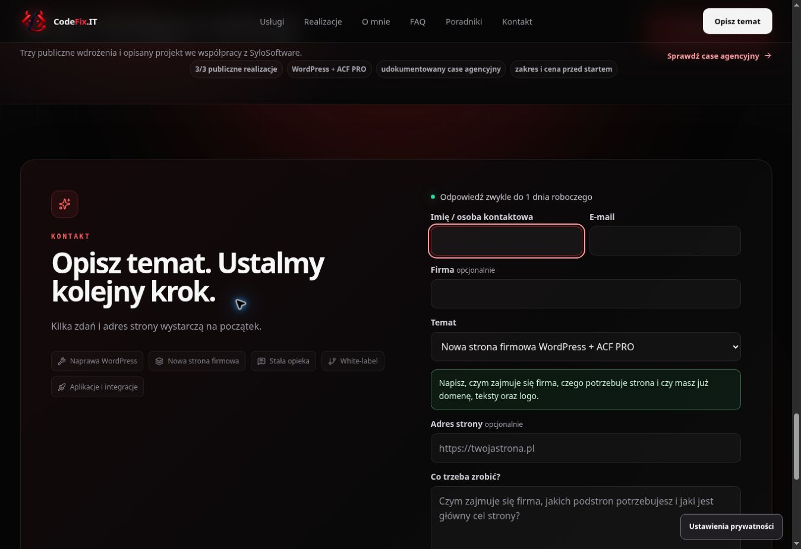
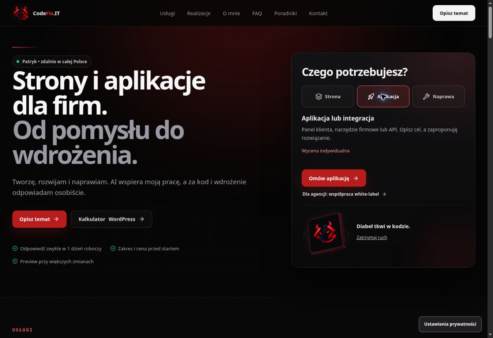

# CodeFix.IT — kontrola przed publikacją, 14.10.2026

Aktualizacja: nowsze wyniki wydajności oraz Chromium/WebKit, wraz z poprawkami kontaktu i prywatności, są w [performance-mobile-v1](performance-mobile-v1.md). Poniższe pomiary opisują wcześniejsze etapy.

Sprawdzono ofertę jednoosobową Patryka, podstrony oraz ścieżki prowadzące do kontaktu. Zachowano aktualny wygląd i widoczne interakcje strony głównej. Wyniki końcowe dotyczą kodu `b368b81` i wdrożenia https://ceb688aa.codefix-it---portfolio-short.pages.dev/. CI #820: success.

## Wykryte i poprawione problemy

- Link „Sprawdź realizacje” na stronie naprawy WordPress wskazywał kotwicę nieobecną w statycznym HTML. Sekcja otrzymała `id="realizacje"`, więc przejście działa także przed uruchomieniem JavaScriptu.
- CTA z portfolio wybierało usługę `CODEFIX_BUSINESS_SITE`, ale po zastąpieniu statycznego HTML przez React pozostawiało użytkownika na pierwszym ekranie. Strona główna przywraca teraz cel kotwicy po zamontowaniu komponentu. Dla `#contact` ustawia również focus na imieniu; efekt anuluje zaplanowaną klatkę przy odmontowaniu.
- Usunięto techniczną etykietę „Zgłoszenie trafia do CRM” z bloku kontaktu na podstronach. Pozostały zakres przed startem i bezpośredni kontakt.
- Opis aplikacji w manifeście obejmuje strony, aplikacje, AI wspierające pracę oraz WordPress. Daty modyfikacji strony głównej i zmienionych stron usługowych w sitemapie odpowiadają bieżącej pracy.

## Weryfikacja

Kontrola HTTP wyjściowego podglądu `1642fd6` objęła wszystkie 20 adresów z sitemapy: HTTP 200, tytuły, opisy, canonical do codefix.it, jeden H1, widoczny statyczny HTML i poprawny JSON-LD. Podgląd ma nagłówek `X-Robots-Tag: noindex`. Nieistniejący adres oraz usunięty dokument QA zwracają rzeczywiste HTTP 404. Nagłówki bezpieczeństwa pozostają obecne.

Nowy `npm run seo:static` sprawdza zbudowane 20 stron, 101 linków wewnętrznych, 6 kotwic, unikalne tytuły, canonical, opisy, H1, ID, JSON-LD, robots.txt i treść strony 404. Test odtworzył błąd brakującej kotwicy przed poprawką i przeszedł po jej dodaniu. Jest uruchamiany w CI po buildzie. Sprawdzenie pliku 404 w tym teście nie zastępuje kontroli statusu HTTP na hostingu.

PASS lokalnie: typecheck, lint, production lint, format, czysty build/prerender, SEO static smoke, estimator, hero motion, measurement consent, mobile CTA i `git diff --check`. Po dodaniu efektu kotwic powtórzono typecheck, production lint, format, czysty build, SEO, pomiary, kontrolę CTA i budżety; pełne CI #820 również przeszło.

| Zasób | Rozmiar | Limit |
| --- | ---: | ---: |
| Entry JS | 200739 B | 215000 B |
| Największy deferred JS | 44323 B | 50000 B |
| Łączny JS | 309722 B | 320000 B |
| Największy CSS | 33782 B | 40000 B |
| Łączny CSS | 69609 B | 70000 B |

Chrome desktop na końcowym wdrożeniu: portfolio → CTA → kontakt wybiera właściwy temat i ustawia focus na `name`. Górna krawędź kontaktu była na 178 px, a pola imienia na 386 px przy wysokości viewportu 936 px; wcześniej kontakt pozostawał ponad 5900 px poniżej ekranu. Poradniki → Usługi kończą na `#services`, z sekcją na 100 px od góry i zerowym poziomym przepełnieniem.

Sprawdzono także ścieżkę poradnik o cenie naprawy → usługa naprawy oraz wymagalność pól i blokadę pustego formularza. Po wdrożeniu ponownie odczytano HTTP strony głównej, naprawy, manifestu i sitemapy: bieżący entry JS, poprawiona kotwica, aktualny opis i data są obecne. Nie wysyłano kolejnego testowego leada; endpoint, payload i sposób obsługi odpowiedzi formularzy pozostały bez zmian.

## Zakres gotowości

Sprawdzone ścieżki i automatyczne kontrole przechodzą. Wcześniejszą kontrolę mobilną opisuje [mobile-home-v1](mobile-home-v1.md); niniejszy etap dodaje efekt obsługi kotwic. Fizyczny iPhone/Safari, aktualny wynik Lighthouse, dane CWV użytkowników i pełny ręczny audyt WCAG nie zostały potwierdzone. PR #91 pozostaje szkicem do oceny przed publikacją na codefix.it.

## Uproszczenie pierwszego ekranu

Nowszy kod `6a5e8c1` skraca opis pod H1 do 95 znaków i usuwa powtórzenie marki z etykiety przy imieniu. Panel wyboru ma jedno pytanie „Czego potrzebujesz?” zamiast dodatkowej instrukcji. Widoczne przyciski, formularz, kalkulator i obsługa ruchu pozostają dostępne. Nie dodano nowych sekcji ani zależności.

PASS: typecheck, production lint, format, czysty build, zgodność tekstów React i statycznego HTML, SEO static smoke oraz budżety. Pełne CI #824 i Cloudflare zakończyły się sukcesem. Entry JS: 200739 B; największy deferred JS: 44200 B; cały JS: 309599 B; cały CSS: 69609 B. Łączny JS jest mniejszy o 123 B od wcześniejszej wersji w tym raporcie.

Na wdrożeniu https://e9a12ea1.codefix-it---portfolio-short.pages.dev/ Chrome potwierdził nowe teksty, jedno pytanie panelu, działające zaznaczenie opcji „Aplikacja” oraz zero poziomego przepełnienia. Ten etap nie obejmował nowego testu na fizycznym telefonie ani pomiaru Lighthouse.

