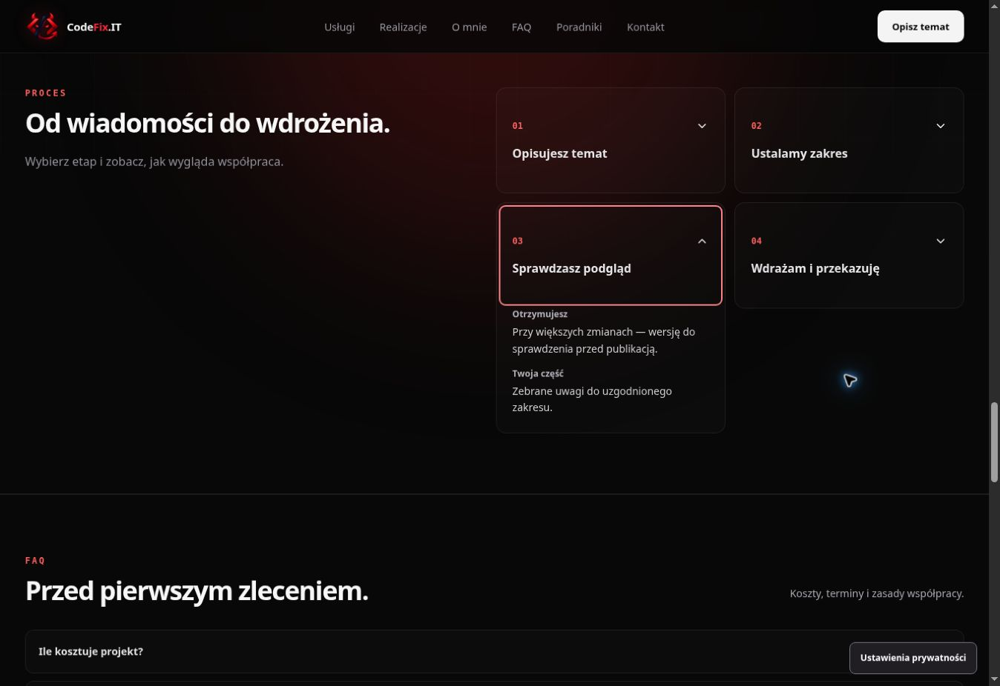

# Klikalne etapy współpracy — produkcja

Data: 16.10.2026. Status: opublikowane i zweryfikowane.

Otwórz [proces współpracy](https://codefix.it/#process) i wybierz jeden z czterech etapów. Rozwinie się krótka informacja „Otrzymujesz” i „Twoja część”. Domyślnie wszystkie etapy są zwinięte, a otwarcie kolejnego zamyka poprzedni.

[PR #106](https://github.com/wwwCodeFixIT/CodeFix.IT---Portfolio-Short/pull/106). Produkcja: `ed804584cb8d79fbbfd9d5bfe1d8ae64c8385324`. Drzewo `02dd63c1d49c9694195c165541c0830ad9ee1c30` jest identyczne z przetestowanym kandydatem `ce07f879391478050643ee94e9f5565b3c786216`.

## Zachowanie

Zachowano istniejącą sekcję i układ: cztery etapy w dwóch kolumnach na komputerze i jednej na telefonie. Cały nagłówek karty jest klikalny. Natywne `details/summary` z grupą `name="codefix-process"` obsługują kliknięcie, Enter i spację. Fokus klawiatury jest widoczny. Treść i rozwijanie są dostępne również w statycznym HTML bez JavaScriptu.

Etapy opisują pierwszą wiadomość, ustalenie zakresu, sprawdzenie podglądu i wdrożenie. Podgląd jest przewidziany przy większych zmianach; zakres, wycena i termin są ustalane przed rozpoczęciem prac. Nie dodano obietnic nieograniczonych poprawek ani sztywnych terminów.

Nie dodano stanu React, zależności, animacji ani API. Formularz pozostał bez zmian.

## Weryfikacja

[Contact Submission Audit #49](https://github.com/wwwCodeFixIT/CodeFix.IT---Portfolio-Short/actions/runs/38916906492): **166 scenariuszy PASS, 114 przechwyconych żądań, 0 rzeczywistych zgłoszeń**.

Nowe 14 przypadków obejmuje Chromium/WebKit × 320/390/1280 px × obie preferencje ruchu oraz po jednym przypadku bez JavaScriptu w obu silnikach. Sprawdzają cztery tytuły i opisy, początkowe zwinięcie, pojedynczy otwarty etap, klawiaturę i kliknięcie, widoczny fokus, cel minimum 44×44 px, brak poziomego przepełnienia oraz zachowanie po zmianie preferencji ruchu. Nowe przypadki nie wykonują zewnętrznych żądań ani wysyłania formularza.

| Obszar audytu | Scenariusze |
| --- | ---: |
| Proces współpracy | 12 + 2 bez JS |
| Kontekst formularza i darmowy projekt | 12 |
| Nawigacja poradników | 12 + 2 bez JS |
| Wyszukiwarka poradników | 12 + 2 bez JS |
| Podgląd realizacji i zakres prac | 12 |
| Formularz krok po kroku | 12 |
| Wysyłanie, walidacja i błędy | 52 |
| Ścieżki poradników i realizacji | 24 |
| Przykłady automatyzacji | 12 |

CI kandydata #965/#966 i [produkcji #967](https://github.com/wwwCodeFixIT/CodeFix.IT---Portfolio-Short/actions/runs/38918221038) — PASS. Typy, ESLint, format, budowa, kontrakty pomiaru, kalkulatora i CTA oraz limity zasobów przeszły. Statyczne SEO: 20 stron, 143 linki wewnętrzne, 48 kotwic. [SEO Production Smoke #98](https://github.com/wwwCodeFixIT/CodeFix.IT---Portfolio-Short/actions/runs/38918220941), [pages build and deployment #117](https://github.com/wwwCodeFixIT/CodeFix.IT---Portfolio-Short/actions/runs/38918218890) i Cloudflare Pages — PASS.

Ręcznie w podglądzie sprawdzono wszystkie cztery etapy. Na produkcji potwierdzono runtime, canonical, początkowe zwinięcie, kliknięcie drugiego etapu i otwarcie trzeciego spacją, zamykanie poprzedniego etapu, teksty, fokus i brak przepełnienia. Formularzy produkcyjnych nie wysyłano.

## Zasoby

Runtime produkcji: `/assets/index-D-tMBduw.js`.

| Zasób | Wynik | Limit |
| --- | ---: | ---: |
| Wejściowy JS | 202191 B | 215000 B |
| Największy odroczony JS | 51358 B | 52000 B |
| Cały JS | 336147 B | 337000 B |
| Największy CSS | 39479 B | 40000 B |
| Cały CSS | 82355 B | 82500 B |

Przyrost: 806 B JS i 656 B CSS. Rozmiar wejściowego JS pozostał bez zmiany. Jawnie zwiększono limity JS: największy odroczony moduł 51000 → 52000 B, suma 336000 → 337000 B. Limity CSS pozostały bez zmiany. Nowego pomiaru Lighthouse ani CWV z rzeczywistego ruchu w tym etapie nie wykonywano.

## Dowód produkcji

Zrzut: 63086 B; SHA-256 `6925899e27e04682abcb214787bb2d3ffe189420db0264eb5f7ce1d870a61313`. Adres: https://codefix.it/#process.

Pełne wyniki i kontrole: [process-steps-20261016.json](qa/process-steps-20261016.json). Dokumentację zachowano na gałęzi `reports/process-steps-20261016`, wraz z dziesięcioma niezmienionymi plikami raportów poprzednich etapów. Raporty są archiwum; kod aplikacji odpowiada opublikowanemu commitowi.
