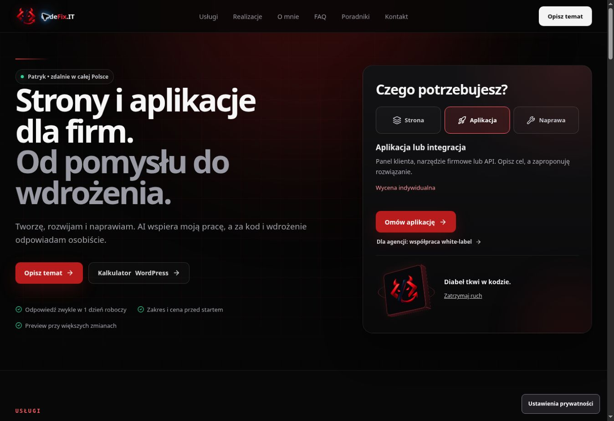

# CodeFix.IT — wdrożenie produkcyjne 14.10.2026

Nowa wersja jest opublikowana na https://codefix.it/. PR #91 scalono 14.10.2026 o 22:15:39 czasu warszawskiego po wyraźnym zleceniu publikacji przez właściciela.

Strona zachowuje dotychczasowy czarno-czerwony wygląd, przedstawia CodeFix.IT jako działalność Patryka i ma krótsze teksty. Widoczne interakcje obejmują wybór potrzeby w pierwszej sekcji, kalkulator WordPress, przeniesienie zakresu do kontaktu i sterowanie animacją. Poprawiono przewijanie i fokus formularza oraz zachowanie ustawień prywatności.

## Wersja produkcyjna

- Merge: `d59e7b452faa68655b6fc21341e6dac34e3c017b`.
- Drzewo: `a2c0ae782148852c1b301ebf3ac561f3bf8feb40` — identyczne z końcowym drzewem PR `614e9c825f0f020072950ca5b61604511fe2125a`.
- Główny plik JavaScript serwowany przez produkcję: `/assets/index-CQajBJcS.js` (200 739 B), identyczny z przetestowanym runtime `e922209ddcd3546f418723b7b2a8a246f48ca0ae`.
- Poprzedni commit main, jako punkt odniesienia w razie potrzeby cofnięcia wdrożenia: `780420a6be3978dd577447305b1bd9a3642211fc`.

## Sprawdzenie po publikacji

Wszystkie poniższe kontrole zakończyły się poprawnie:

- [CI #847](https://github.com/wwwCodeFixIT/CodeFix.IT---Portfolio-Short/actions/runs/38630553292), [SEO Production Smoke #81](https://github.com/wwwCodeFixIT/CodeFix.IT---Portfolio-Short/actions/runs/38630553304) oraz [pages build and deployment #102](https://github.com/wwwCodeFixIT/CodeFix.IT---Portfolio-Short/actions/runs/38630550702) dla dokładnego merge SHA.
- HTTP 200 strony głównej, poprawny canonical `https://codefix.it/`, brak nagłówka noindex na stronie głównej i prawidłowe pobranie początkowych plików JS/CSS.
- `SITE_URL=https://codefix.it node scripts/seo-production-smoke.mjs`: robots.txt, sitemap zgodna z 20 adresami repozytorium, odpowiedzi 200, indeksowalne statyczne HTML, canonical, tytuły i opisy oraz rzeczywiste 404 z noindex.
- Przeglądarka Chrome na produkcji: wybór „Aplikacja” ustawia aktywny przycisk i CTA „Omów aplikację”; kliknięcie wybiera `development` w kontakcie i ustawia fokus na imieniu, widocznym w oknie. Brak przewijania poziomego.
- Kalkulator na produkcji: „Stała opieka” + „3 miesiące” daje „Od 900 zł / 3 mies.”. Przeniesienie zakresu wybiera `WORDPRESS_CARE`, dołącza właściwy brief i ustawia fokus na widocznym polu imienia.

Nie wysyłano nowego zapytania z formularza ani nie tworzono nowego leada w ramach kontroli po wdrożeniu. Po sprawdzeniu usunięto zakres z lokalnego formularza, zwinięto kalkulator i pozostawiono stronę w pierwszej sekcji.

## Wcześniejsza walidacja tej samej aplikacji

[Contact Viewport Audit #2](https://github.com/wwwCodeFixIT/CodeFix.IT---Portfolio-Short/actions/runs/38622017019) zakończył się sukcesem: 8 scenariuszy zmiany wysokości i 12 scenariuszy kontaktu, razem 20. Lighthouse na podglądzie tej samej aplikacji: mediana wydajności mobile 99 (zakres 92–99), desktop 100; dostępność i best practices 100. Wyniki SEO podglądu były ograniczone celowym noindex i nie są pomiarem SEO produkcji. Szczegóły: [contact-viewport-v1.md](contact-viewport-v1.md).

Test klawiatury na fizycznym iPhonie pozostaje niepotwierdzony. Automatyczne zmiany wysokości okna nie zastępują takiego testu.

Ten raport i zrzut zapisano na osobnej gałęzi `reports/production-20261014`; nie zmieniają kodu ani commitu produkcji.
