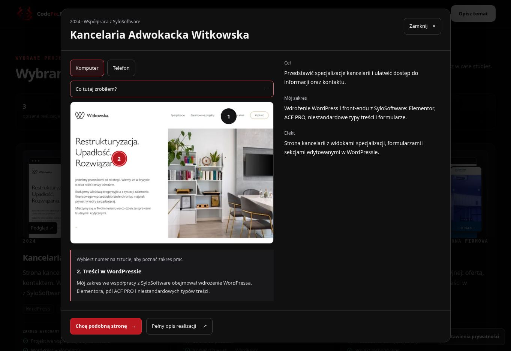

# Klikalny zakres prac w realizacjach — produkcja

Data: 16.10.2026. Status: opublikowane i zweryfikowane.

Otwórz https://codefix.it/#work → podgląd wybranej realizacji → **Co tutaj zrobiłem?** → numer na zrzucie.

[PR #105](https://github.com/wwwCodeFixIT/CodeFix.IT---Portfolio-Short/pull/105). Produkcja: `edc9bef5d3cd7cee730421b07ec5d72029e70441`. Drzewo `88044c76b163f681d143c312fe639c409d49f6ac` jest identyczne z przetestowanym kandydatem `d7b6e830654a06187cc827fdb45c2d940f3571fb`.

## Zachowanie

Każda z 3 realizacji w istniejącym podglądzie na stronie głównej ma 2 punkty opisujące udokumentowany zakres prac. Punkty i opis pojawiają się po rozwinięciu „Co tutaj zrobiłem?”. Wybranie numeru zmienia jeden krótki opis. Zrzuty i informacje pochodzą z istniejących zasobów projektu; nie dodano fikcyjnych porównań ani nowych sekcji.

Pozycje punktów są osobne dla widoku komputera i telefonu. Wybór pozostaje przy przełączeniu urządzenia. Zwinięcie usuwa punkty, a ponowne rozwinięcie i otwarcie nowej realizacji przywraca pierwszy punkt. W obu objaśnieniach kancelarii zachowano współpracę z SyloSoftware.

Kontrolki to natywne przyciski z celem 44×44 px, widocznym fokusem, `aria-expanded`, `aria-pressed` i `aria-controls`. Opis ma `aria-live="polite"`. Pozycje są ograniczone do granic faktycznego obrazu. Nie dodano animacji, zależności ani API. Komponent i opisy ładują się razem z opcjonalnym modułem ProjectQuickView.

## Weryfikacja

[Contact Submission Audit #48](https://github.com/wwwCodeFixIT/CodeFix.IT---Portfolio-Short/actions/runs/38913465301): **152 scenariusze PASS, 114 przechwyconych żądań, 0 rzeczywistych zgłoszeń**.

12 kombinacji testu podglądu: Chromium/WebKit × 320/390/1280 px × obie preferencje ruchu. Każda sprawdza wszystkie 3 projekty i 6 punktów: domyślny stan zamknięty, klawiaturę i kliknięcie, opis wybranego numeru, granice obrazu w obu widokach, zachowanie wyboru, reset i informację o współpracy. Dotychczasowe kontrole dialogu, lazy loadingu, Escape, tła, powrotu fokusu i dołączania realizacji do briefu również przeszły.

| Pozostałe obszary audytu | Scenariusze |
| --- | ---: |
| Kontekst formularza i darmowy projekt | 12 |
| Nawigacja poradników | 12 + 2 bez JS |
| Wyszukiwarka poradników | 12 + 2 bez JS |
| Formularz krok po kroku | 12 |
| Wysyłanie, walidacja i błędy | 52 |
| Ścieżki poradników i realizacji | 24 |
| Przykłady automatyzacji | 12 |

CI kandydata #962/#963 i produkcji #964 — PASS. Typy, ESLint, format, budowa, kontrakty pomiaru i kalkulatora oraz limity zasobów przeszły. Statyczne SEO: 20 stron, 143 linki wewnętrzne, 48 kotwic. [SEO Production Smoke #97](https://github.com/wwwCodeFixIT/CodeFix.IT---Portfolio-Short/actions/runs/38914675292) — PASS. Cloudflare Pages i pages build and deployment #116 — PASS.

Ręcznie w podglądzie sprawdzono wszystkie 3 projekty. Na produkcji potwierdzono runtime, canonical, drugi punkt kancelarii, informację o SyloSoftware, zachowanie wyboru przy zmianie urządzenia, zwijanie i powrót fokusu. Formularzy produkcyjnych nie wysyłano.

## Zasoby

Runtime produkcji: `/assets/index-C7LF1t9U.js`.

| Zasób | Wynik | Limit |
| --- | ---: | ---: |
| Wejściowy JS | 202191 B | 215000 B |
| Największy odroczony JS | 50552 B | 51000 B |
| Cały JS | 335341 B | 336000 B |
| Największy CSS | 38823 B | 40000 B |
| Cały CSS | 81699 B | 82500 B |

Przyrost: 2606 B JS i 1113 B CSS w opcjonalnym podglądzie. Rozmiar wejściowego JS i największej trasy bez zmiany. Jawnie zwiększono limity sum: JS 333000 → 336000 B, CSS 81000 → 82500 B. Nowego pomiaru Lighthouse ani CWV z rzeczywistego ruchu w tym etapie nie wykonywano.

## Dowód produkcji

Pełne przypadki, kontrole CI i hash zrzutu: [project-insights-20261016.json](qa/project-insights-20261016.json). Dokumentację zachowano na gałęzi `reports/project-insights-20261016`, wraz z siedmioma plikami raportów poprzednich etapów.
