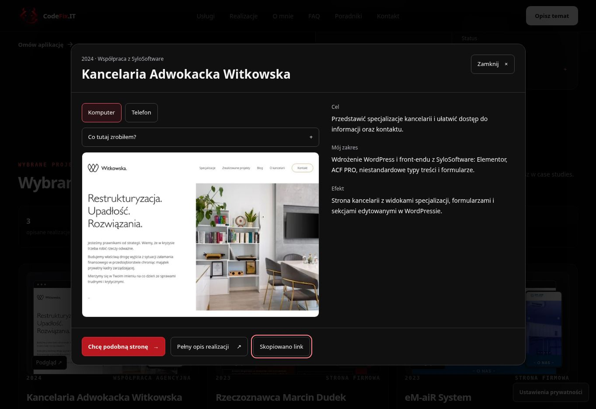

# Kopiowanie linków do realizacji — produkcja

Data: 16.10.2026. Status: opublikowane i zweryfikowane.

[CodeFix.IT → Realizacje](https://codefix.it/#work) → podgląd wybranego projektu → **Skopiuj link**. W schowku znajdzie się publiczny adres pełnego opisu tej realizacji.

[PR #107](https://github.com/wwwCodeFixIT/CodeFix.IT---Portfolio-Short/pull/107). Produkcja: `d147f93fd6552d02655b8f8acb81645a9278126d`. Drzewo `f1cec5f2bb993415b60c763a58912206f384f8de` jest identyczne z przetestowanym kandydatem `78e574a894e1223684413e2daf1eddb8ba211e98`.

## Zachowanie

Dodano jeden przycisk w istniejącym podglądzie trzech realizacji. Kopiuje adres `https://codefix.it/realizacje/{slug}/` bez parametrów reklamowych, hasha i hosta podglądu. Powodzenie potwierdza napis „Skopiowano link” i komunikat dla czytnika ekranu.

Przy odmowie dostępu lub braku API schowka pojawia się pole z publicznym adresem. Pole jest tylko do odczytu, automatycznie otrzymuje fokus i zaznaczenie tekstu. Uwzględniono je w kolejności tabulatora i pułapce fokusu dialogu. Podczas oczekiwania przycisk jest zablokowany. Zamknięcie podglądu i otwarcie innego projektu resetuje stan; zakończenie wcześniejszego kopiowania nie zmienia nowego okna.

Funkcja ładuje się razem z opcjonalnym modułem ProjectQuickView. Nie dodano zależności, animacji ani żądań sieciowych. Formularz i statyczne odnośniki do realizacji pozostały bez zmian.

## Weryfikacja

[Contact Submission Audit #50](https://github.com/wwwCodeFixIT/CodeFix.IT---Portfolio-Short/actions/runs/38920105036): **166 scenariuszy PASS, 114 przechwyconych żądań, 0 rzeczywistych zgłoszeń**.

Rozszerzono 12 kombinacji podglądu: Chromium/WebKit × 320/390/1280 px × obie preferencje ruchu. Każda sprawdza linki wszystkich trzech projektów, pominięcie UTM/gclid, kopiowanie Enter/spacją, odmowę i brak schowka, ponowienie, zaznaczenie i fokus pola ręcznego kopiowania, Tab/Shift+Tab w dialogu, oczekujące kopiowanie po zamknięciu oraz reset innego projektu. Istniejące kontrole obrazów, opisów zakresu, informacji o SyloSoftware, zamykania okna i dołączania realizacji do briefu również przeszły.

| Obszar audytu | Scenariusze |
| --- | ---: |
| Podgląd realizacji, zakres prac i kopiowanie linków | 12 |
| Proces współpracy | 12 + 2 bez JS |
| Kontekst formularza i darmowy projekt | 12 |
| Nawigacja poradników | 12 + 2 bez JS |
| Wyszukiwarka poradników | 12 + 2 bez JS |
| Formularz krok po kroku | 12 |
| Wysyłanie, walidacja i błędy | 52 |
| Ścieżki poradników i realizacji | 24 |
| Przykłady automatyzacji | 12 |

CI kandydata #968/#969 i [produkcji #970](https://github.com/wwwCodeFixIT/CodeFix.IT---Portfolio-Short/actions/runs/38921372707) — PASS. Typy, ESLint, format, budowa, kontrakty pomiaru, kalkulatora, ruchu i mobilnego CTA oraz limity zasobów przeszły. Statyczne SEO: 20 stron, 143 linki wewnętrzne, 48 kotwic. [SEO Production Smoke #99](https://github.com/wwwCodeFixIT/CodeFix.IT---Portfolio-Short/actions/runs/38921372693), [pages build and deployment #118](https://github.com/wwwCodeFixIT/CodeFix.IT---Portfolio-Short/actions/runs/38921371719) i Cloudflare Pages — PASS.

Ręcznie w podglądzie skopiowano adresy wszystkich trzech projektów klawiaturą i myszą. Sprawdzono też, że skopiowany adres eM-aiR System otwiera właściwy opis z poprawnym canonical. Na produkcji potwierdzono runtime, canonical strony głównej, kopiowanie linku kancelarii, komunikat powodzenia, widoczny fokus, brak poziomego przepełnienia i informację o SyloSoftware. Formularzy produkcyjnych nie wysyłano.

## Zasoby

Runtime produkcji: `/assets/index-CqWe8SDg.js`.

| Zasób | Wynik | Limit |
| --- | ---: | ---: |
| Wejściowy JS | 202191 B | 215000 B |
| Największy odroczony JS | 51358 B | 52000 B |
| Cały JS | 337033 B | 338000 B |
| Największy CSS | 39479 B | 40000 B |
| Cały CSS | 82856 B | 83000 B |

Przyrost: 886 B JS i 501 B CSS w opcjonalnym dialogu. Wejściowy JS, największy odroczony moduł i największy CSS pozostały bez zmiany. Jawnie dostosowano limity sum: JS 337000 → 338000 B, CSS 82500 → 83000 B. Nowego pomiaru Lighthouse ani CWV z rzeczywistego ruchu w tym etapie nie wykonywano.

## Dowód produkcji

Zrzut: 100377 B; SHA-256 `34e24abda7eaacdf4828f91117c8bf2da849ef451586cd6a0f19615ed0f02bac`. Adres: https://codefix.it/#work.

Pełne wyniki i kontrole: [project-share-20261016.json](qa/project-share-20261016.json). Dokumentację zachowano na gałęzi `reports/project-share-20261016`, wraz z trzynastoma niezmienionymi plikami raportów poprzednich etapów. Archiwum nie zmienia opublikowanej aplikacji.
